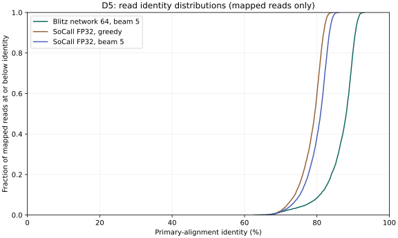

<p class="eyebrow">Technical investigation · Phase 2</p>

# DeepNano-Blitz vs SoCall: Reference Accuracy on D5

## Objective

Compare mapping and reference identity for DeepNano-Blitz network 64 / beam 5 and two FP32 SoCall decoder configurations on the same D5 reads.

## Work Performed

The scoring follow-up, [BLITZ-010](../experiments/BLITZ-010.md), evaluated the retained BLITZ-007 run-1 FASTQ. The comparison script recomputes numeric summaries from the three saved alignment CSVs, checks reference and scoring metadata, and verifies **4,467 unique, identical read IDs** across configurations. The follow-up used existing outputs and performed no new basecalling, timing or power runs.

## Experimental Setup / Methodology

[D5](../datasets/D5.md) contains 4,467 FAST5 reads and 1,290,238,981 signal samples at 4 kHz from Wick's *Acinetobacter pittii* 16-377-0801 dataset. The reference is the corresponding 3,814,719 bp circular chromosome. The R9.4-labelled acquisition is consistent at the family and sampling-rate level with the reported model context for Blitz and SoCall. Exact pore/motor matching and training overlap remain unverified. [Blitz model record](../models/blitz-network64.md) · [SoCall model record](../models/socall-private.md) · [Wick et al. (2019)](https://link.springer.com/article/10.1186/s13059-019-1727-y)

| Output | Recorded configuration | Execution and source |
|---|---|---|
| Blitz | Network 64, beam 5, 8 caller threads, `OMP_NUM_THREADS=1` | Ryzen 7 7800X3D / Ubuntu WSL, BLITZ-007 run 1, basecalled 24 Oct; scored 23 Nov ([BLITZ-010](../experiments/BLITZ-010.md)) |
| SoCall greedy | Supplied FP32 weights, 4,800-sample chunks, no overlap, batch 64; per-read median/MAD normalization | Apple M2 / MPS, 19 Nov ([SOCALL-001](../experiments/SOCALL-001.md)) |
| SoCall beam 5 | Same recorded SoCall setup, beam width 5 | Apple M2 / MPS, 19 Nov ([SOCALL-002](../experiments/SOCALL-002.md)) |

The two beam-5 configurations differ in model, preprocessing and decoder implementation. The comparison uses the saved Apple M2 SoCall outputs.

### Scoring and verification

All three use `minimap2 via mappy 2.31`, preset `map-ont` and primary alignments only. The uncompressed reference has this SHA-256.

```text
b846951645ed1f5218da21539125c7e3110ec9c78f5956896aa2d0e554617958
```

The scoring script is pinned to repository commit `5db279483d38ed8d7efc303e5561060ecd450b87` (script SHA-256 `c0046e5b0621f11a77078139fa1469fc3a0d51dc664d71bbc0cd05aa176ce649`).

Identity is `M/(M+S+I+D)`, where M is matches, S substitutions, I inserted bases and D deleted bases. Median identity weights mapped reads equally; pooled identity weights alignment columns. Error rates use the pooled alignment-column denominator. Unmapped reads remain in the mapping-rate denominator, but are excluded from identity/error statistics. Aligned-base fraction reports aligned query bases divided by all predicted query bases, including unmapped reads; it is not reference-genome coverage.

## Results

<!-- d5-accuracy:summary -->



The chart describes identity among mapped reads. The tables account for unmapped reads.

### Comparison by read ID

<!-- d5-accuracy:paired -->

Blitz's overall median exceeds SoCall beam 5 by **7.09 percentage points**. Among reads mapped by both, the median per-read difference is **6.93 percentage points**. The paired statistic excludes mapping failures.

## Findings

Blitz mapped more reads than either SoCall configuration and had higher identity on most shared mapped reads. SoCall beam 5 improved mapped-read identity over greedy decoding on D5. The comparison covers the tested pipelines and does not isolate which stage explains the gap.

## Limitations

- The comparison used one bacterial isolate and one frozen output per configuration. Consensus accuracy, variant accuracy and clinical performance were outside its scope.
- Primary local alignments can omit difficult read ends and other unaligned regions. This analysis did not specifically evaluate split alignments or circular-reference boundaries.
- Basecalling hardware, models, preprocessing and decoding differed. The comparison provides no controlled speed, memory, energy or live-throughput measurement. BLITZ-007 timing and BLITZ-008 package energy are separate experiments.
- FASTQs remain outside the repository. The comparison did not independently re-hash or realign them or re-hash the input signals. Identical output IDs verify matching read identifiers.

## Next Steps

Inspect poor alignments and unaligned regions, then evaluate changes to SoCall normalization, chunks and decoding one at a time. Repeat on compatible reference-backed datasets with verified training/evaluation separation. Measure execution and energy on common hardware and input with matched timing and electrical boundaries before ranking efficiency.

## Reproduction

Use Python 3.12 with `mappy==2.31` to repeat the alignment step. Install the Ubuntu `zlib1g-dev` build dependency if mappy must be compiled. Use the retained BLITZ-007 `run1.fastq` and the D5 reference from the [dataset card](../datasets/D5.md), verify hashes, and run from `~/capstone-blitz/comparison-d5`:

```bash
python reference_accuracy.py \
  ~/capstone-blitz/deepnano-blitz/benchmarks/large-dataset-20261024-201712/run1.fastq \
  reference.fasta \
  --out-dir blitz-d5-accuracy
```

To reproduce the comparison from the checked-in scoring evidence, from the public repository root:

```bash
python harness/analysis/compare_d5_accuracy.py
python harness/analysis/compare_d5_accuracy.py --check
# Optional chart regeneration (requires matplotlib):
python harness/analysis/compare_d5_accuracy.py --plot
```

[Comparison JSON and artifact hashes](../results/summaries/d5-accuracy-comparison.json) · [Blitz accuracy JSON](../results/raw/brian-7800x3d/blitz/reference-accuracy/BLITZ-010/accuracy.json) · [Blitz per-read CSV](../results/raw/brian-7800x3d/blitz/reference-accuracy/BLITZ-010/alignments.csv).

SoCall source artifacts: [greedy JSON](https://github.com/erodrigues303/eng4000-real-time-dna-analysis-for-portable-sequencing/blob/5db279483d38ed8d7efc303e5561060ecd450b87/results/raw/ege-m2/socall/reference-accuracy/SOCALL-001/accuracy.json), [greedy CSV](https://github.com/erodrigues303/eng4000-real-time-dna-analysis-for-portable-sequencing/blob/5db279483d38ed8d7efc303e5561060ecd450b87/results/raw/ege-m2/socall/reference-accuracy/SOCALL-001/alignments.csv), [beam-5 JSON](https://github.com/erodrigues303/eng4000-real-time-dna-analysis-for-portable-sequencing/blob/5db279483d38ed8d7efc303e5561060ecd450b87/results/raw/ege-m2/socall/reference-accuracy/SOCALL-002/accuracy.json), [beam-5 CSV](https://github.com/erodrigues303/eng4000-real-time-dna-analysis-for-portable-sequencing/blob/5db279483d38ed8d7efc303e5561060ecd450b87/results/raw/ege-m2/socall/reference-accuracy/SOCALL-002/alignments.csv).

## Related Investigations and Evidence

- [DeepNano-Blitz CPU Scaling and Energy Efficiency](cpu-parallelism.md)
- [SoCall engineering](../socall/index.md)
